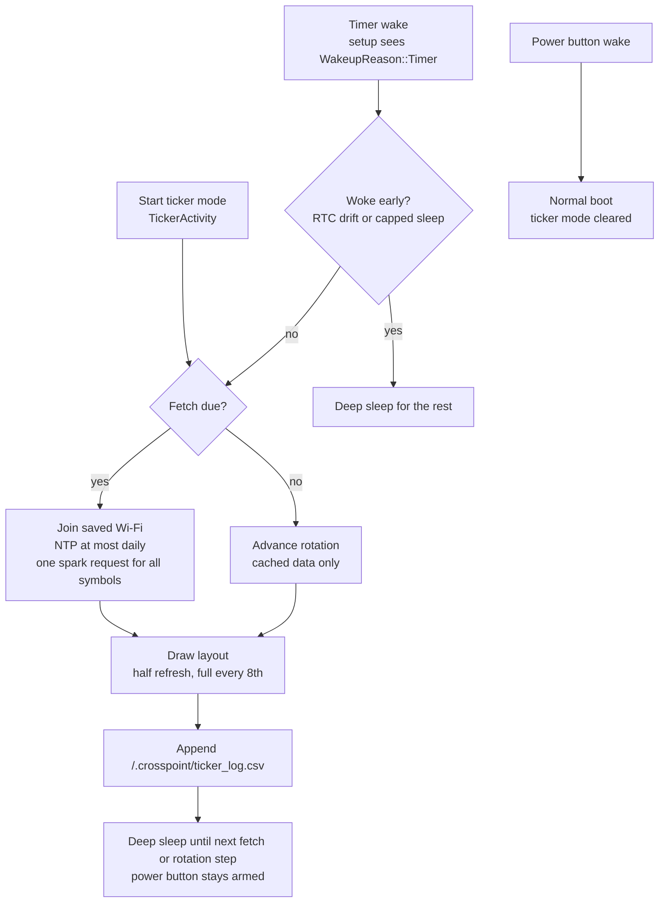

# Stock Ticker: developer guide

How the [Stock Ticker](stock-ticker.md) is built, how to build it, and how to test layouts on a real device without touching it.

## Architecture

The ticker never stays awake. "Running" means the X3 is in deep sleep with the last frame on the e-ink panel. Each wake is a fresh boot that does one small job, then sleeps again.



### Files

| Path | Role |
| --- | --- |
| `src/ticker/Ticker.h/.cpp` | Config (`/.crosspoint/ticker.json`), quote cache (`ticker_cache.json`), Wi-Fi join, Yahoo fetch and parse, New York market schedule, wake bookkeeping kept in RTC memory |
| `src/ticker/TickerCustom.cpp` | Custom image: download to SD with Wi-Fi up, then validate or convert (PNG to 1-bit BMP) with Wi-Fi off, and swap in only a known-good image |
| `tools/stock-ticker/webhook_server.py` | Webhook receiver that renders the latest payload (text, items, image, chart) to a 1-bit PNG |
| `src/ticker/TickerLogic.h/.cpp` | Pure logic with no Arduino, storage or network calls: New York calendar and DST, refresh schedule, symbol parsing, page logic, Yahoo spark parsing. Shared by the firmware and the host tests |
| `test/ticker_logic/` | Google Test suite for `TickerLogic`, including a real Yahoo response in `fixtures/` |
| `tools/stock-ticker/test_webhook_server.py` | Unit tests for the webhook server |
| `src/ticker/TickerScreen.cpp` | Rendering: grid cards, single-symbol page, seven-segment price digits, charts, status line, logos |
| `src/activities/settings/TickerActivity.*` | The settings menu and the full-screen preview |
| `src/main.cpp` | `runTickerCycle()`, the timer-wake branch in `setup()`, `enterTickerSleep()`, and the serial debug commands |
| `lib/hal/HalGPIO.*` | Adds `WakeupReason::Timer` |
| `lib/hal/HalPowerManager.*` | `startDeepSleep(gpio, timerWakeSeconds)` arms a timer alongside the power button |
| `src/images/IntelLogo.h`, `BitcoinLogo.h` | 1-bit logos made with `tools/stock-ticker/gen_logo.py` |
| `lib/I18n/translations/english.yaml` | `STR_TICKER_*` strings |

### Design decisions

- **X3-only timer wake.** In `HalPowerManager::startDeepSleep()`, both Xteink C3 boards drive GPIO13 low before sleeping. On the X3 that pin switches the SD-card power, so the chip stays in real deep sleep and a timer can wake it. On the X4 the same pin cuts battery power, so no timer can fire. See the `XTEINK_X3` profile in `freeink-sdk/libs/hardware/BoardConfig/include/BoardConfig.h`. The app checks `gpio.deviceIsX3()` before arming.
- **One request for all symbols.** `v7/finance/spark?symbols=A,B,C&range=1d&interval=15m` returns metadata and intraday closes for every symbol. That's about 2 KB per stock and about 6 KB per crypto pair. A 24-hour crypto series is thinned evenly to 48 points, always keeping the latest. The parser uses an ArduinoJson filter, so the parsed document stays at about 3.5 KB.
- **No new state in the SD settings format.** Config and cache are separate small JSON files. Schedule, rotation index, retry count and the cached access point (BSSID and channel, for faster joins) live in `RTC_DATA_ATTR` variables, which survive deep sleep without any SD writes.
- **Clock.** "Now" comes from the X3's DS3231 clock chip through `HalClock`, with NTP re-sync at most once per day. New York time and DST are computed from the UTC epoch (`nyOffsetSeconds()`), independent of the user's timezone. Sleeps are capped at 3 hours, and early wakes go back to sleep, which bounds drift in the chip's internal sleep timer.
- **CPU speed before Wi-Fi.** The UI drops the CPU to a low-power clock when idle, and the Wi-Fi radio won't start at that clock. `connectWifi()` calls `powerManager.setPowerSaving(false)` first. Power saving then stays off while Wi-Fi is up.
- **Memory.** A fetch inside the UI leaves about 33 KB fragmented until a reboot. The activity reboots back to Settings on exit, like CrossPoint's other Wi-Fi screens. A second fetch in the same visit is refused by the TLS memory pre-check, and the screen shows *Low memory*. Timer wakes always start from a fresh boot, so they never see a fragmented heap.
- **Custom images decode with Wi-Fi off.** Converting a 792 × 528 PNG to a 1-bit BMP needs the PNG decoder plus dither row buffers. With the radio up, the first conversion after boot ran out of memory (`OOM: Atkinson1BitDitherer`). Downloading first, then turning Wi-Fi off before converting, fixed it. The end-to-end test compares the reader's screen with the served image pixel by pixel.
- **Big digits.** Built-in fonts top out at 18 pt, so prices use drawn seven-segment glyphs that scale down to fit their box (`fitBigHeight()`). Logos are plotted pixel by pixel because `GfxRenderer::drawImage()` doesn't rotate bits for landscape.

## Building

```bash
pip install platformio
pio run -e default        # development build: debug logging, serial debug commands
pio run -e gh_release     # release build
```

The output is `.pio/build/<env>/firmware.bin`, an app image for offset `0x10000`. See [install](stock-ticker-install.md) for flashing.

### Build setup problems on Linux

- **`ensurepip is not available`:** install the venv package for your Python version, for example `sudo apt install python3.10-venv`, then delete `~/.platformio/penv` and build again.
- **`ModuleNotFoundError: No module named 'SCons.Tool.FortranCommon'` at link time:** the pioarduino platform and PlatformIO Core both manage the `tool-scons` package, and on some setups each removes the other's copy partway through the build. One workaround is to keep the Core's copy and stop the platform from managing SCons. Remove `tool-scons` from `COMMON_IDF_PACKAGES` in `~/.platformio/platforms/espressif32/platform.py` and from `packages` in `platform.json`, then run:
  ```bash
  pio pkg install -g -t "platformio/tool-scons@~4.41101.0"
  ```

## Unit tests

**Firmware logic** uses Google Test, like CrossPoint's other host tests:

```bash
cmake -S test -B build/test
cmake --build build/test --target TickerLogicTest
build/test/ticker_logic/TickerLogicTest
```

`pio run -t unit-tests` builds and runs every suite, including this one. The 23 tests cover:

- **Calendar and New York time:** days-since-epoch, US daylight-saving dates, and the offset switching exactly at 02:00 local time
- **Market hours:** open and closed times, the one-minute early-wake tolerance, weekends, winter time, and an unknown clock
- **Refresh schedule:** in-market interval, landing on the 16:05 after-close refresh, sleeping to the next open across weekends, hourly crypto off-hours, market-hours-off, and image-only mode
- **Symbols:** cleaning, uppercasing, length limit, separators, duplicates, the 4-symbol cap, and junk input
- **Pages:** grid, rotate, and the custom image as the only page or an extra last page
- **Yahoo parsing** against a saved real response: stock fields, crypto detection, volumes above 32 bits, thinning 84 points to at most 48 while keeping the latest, skipped nulls, and rejected entries

**Webhook server** uses Python's `unittest` and Pillow, with no network access needed:

```bash
python3 -m unittest -v tools/stock-ticker/test_webhook_server.py
```

The 32 tests cover body parsing, size parameters, every `items` form, chart filtering, layout in both orientations, clipping and overflow, hostile payloads, image decoding and transparency, re-fetching a changed image at the same URL, and the HTTP responses (PNG, BMP, status, 400, 404, 413).

## Testing layouts on the device (no button presses)

Development builds (`default` environment) accept serial commands:

| Command | Effect |
| --- | --- |
| `CMD:SCREENSHOT` | Dumps the framebuffer (upstream CrossPoint) |
| `CMD:TICKER FETCH` | Joins Wi-Fi and refreshes the quote cache for the saved symbols; replies `TICKER_FETCH:1` or `TICKER_FETCH:0` |
| `CMD:TICKER URL <mode> <url>` | Sets the custom image mode (0 = off, 1 = only, 2 = extra page) and URL, and saves them; replies `TICKER_URL:...` |
| `CMD:TICKER CUSTOM` | Downloads the custom image, converts it with Wi-Fi off, and shows it; replies `TICKER_CUSTOM:1` or `TICKER_CUSTOM:0` |
| `CMD:TICKER SHOW <layout> <orientation> <page> <symbols>` | Draws a layout from cached quotes without changing the saved config; replies `TICKER_SHOWN`. Layout: 0 = grid, 1 = rotate. Orientation: 0 = portrait, 1 = landscape CCW, 2 = landscape CW |

`tools/stock-ticker` wraps them:

```bash
cd /tmp/ticker-shots
~/.platformio/penv/bin/python <repo>/tools/stock-ticker/serial_logger.py 3600 . &   # logs and screenshots (no --follow)
echo "TICKER FETCH" > cmd.req                                                     # refresh quotes
<repo>/tools/stock-ticker/show.sh 0 0 0 "INTC,BTC-USD" grid-portrait-2.png         # draw and capture
```

`serial_logger.py` writes `serial.log`, sends the command in `cmd.req`, and saves a screenshot when `shot.req` appears. **Opening the X3's USB serial port can reset the chip** (`rst:0x15 USB_UART_CHIP_RESET`). So the logger connects once and stops when the port drops. `--follow` reconnects after sleep and restarts, but each reconnect may reset the reader. In our testing that kept rebooting the reader out of File Transfer. Use `--follow` only for watching ticker wakes, and never while testing the web server. The screenshots in [stock-ticker.md](stock-ticker.md) were made this way.

The serial log also shows each ticker wake:

```text
[TICK] Joining <ssid> (cached BSSID)
[TICK] Wi-Fi up in 1674 ms
[TICK] BTC-USD 82410.72 (prev 83673.01), 37 points, crypto
[TICK] INTC 101.07 (prev 104.70), 22 points
[TICK] Sleeping 900 s
```

## Logos

```bash
python3 tools/stock-ticker/gen_logo.py logo.svg src/images/FooLogo.h <width> Foo
```

This writes `FOO_LOGO_W`, `FOO_LOGO_H` and `FooLogo[]` (1 bpp, MSB-first, bit 1 = ink) and a preview PNG. To register a symbol, add it to `logoFor()` in `TickerScreen.cpp`. Keep logos about 62 px tall; the grid draws them at half size.

## Ideas

- A 2 × 3 landscape grid (6 cards per page) as an option
- Exchange holiday calendar
- Partial e-ink refresh for rotation-only wakes
- Price alerts with an inverted card when a threshold is crossed
