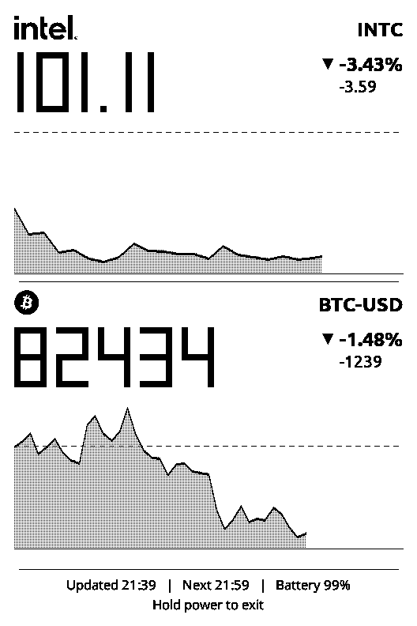
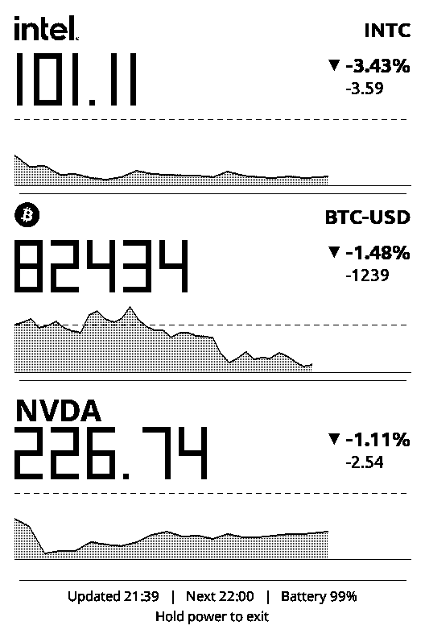
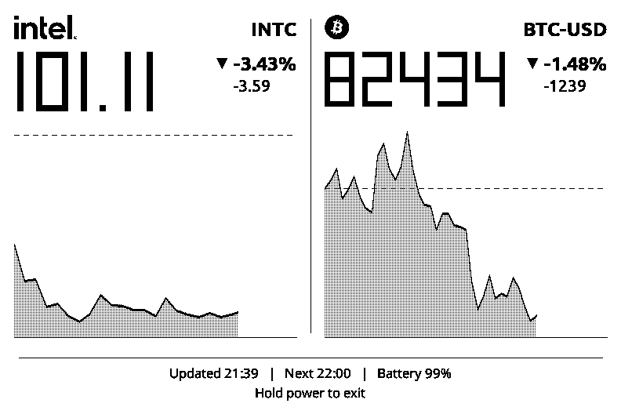
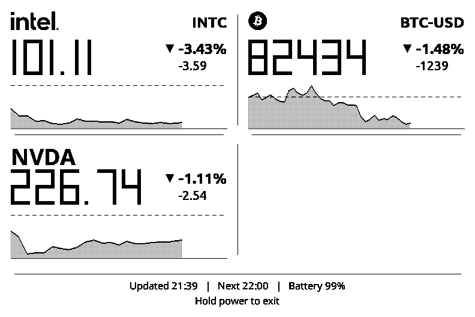
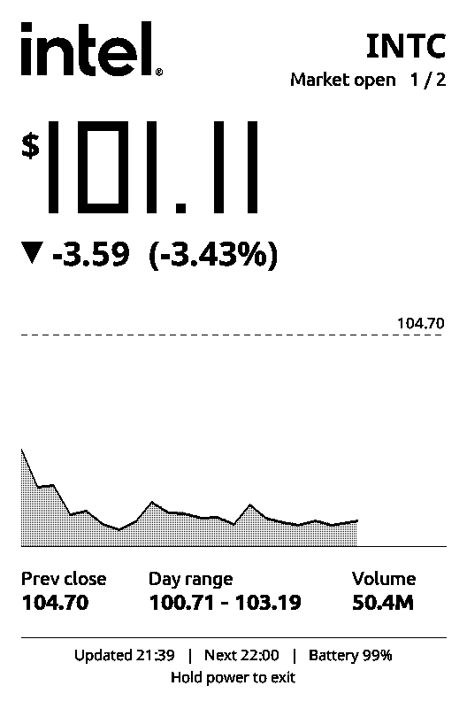
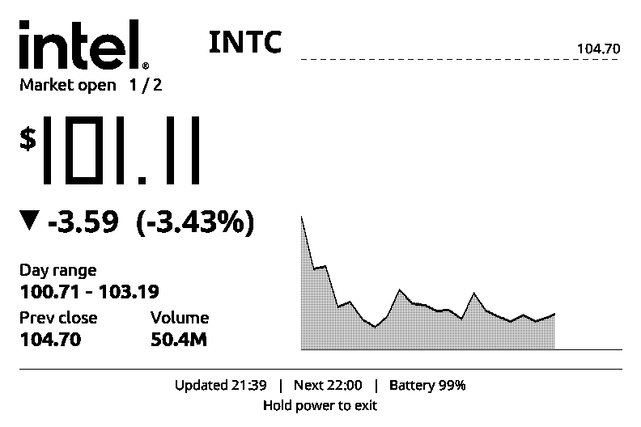
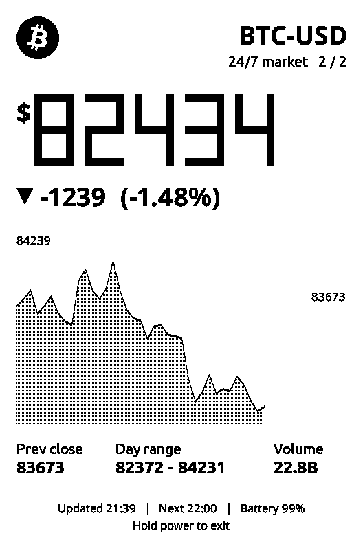
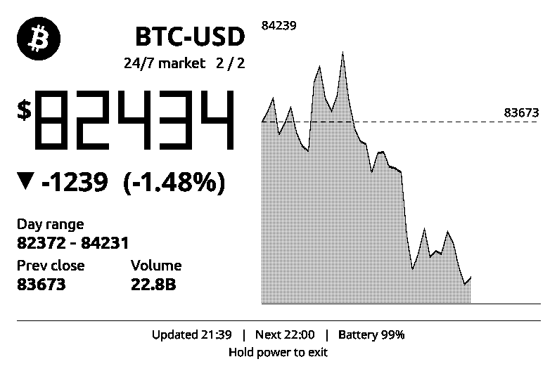

# Stock Ticker

A low-power stock and crypto dashboard for the **Xteink X3**. The reader shows up to four symbols, such as Intel and Bitcoin, refreshes them over Wi-Fi on a schedule, and spends the time in between in deep sleep. E-ink keeps the image on screen without power.

> **X3 only.** The ticker wakes itself on a timer. That works on the X3 because its sleep mode keeps the chip in real deep sleep. The X4 uses the same "sleep" to cut battery power, so a timer can't wake it, and the app refuses to start ticker mode there.

## What it shows

Each symbol gets:

- **Price**, in large digits that stay readable across a room
- **Change today** versus the previous close, with an up or down arrow
- **Intraday chart**, with a dashed line at the previous close
- **Day range, previous close and volume** (single-symbol layout)
- **Logo** for Intel (`INTC`) and Bitcoin (`BTC-…`); other symbols show their ticker

A status line at the bottom shows when the data was fetched, when the next update is due, and the battery level. If a fetch fails, the status line switches to **Offline** with the time of the data still on screen.

## Layouts

**All on one screen** draws one card per symbol: a grid of up to 4, stacked in portrait and 2 × 2 in landscape.

| Portrait, 2 symbols | Portrait, 3 symbols |
| --- | --- |
|  |  |

| Landscape, 2 symbols | Landscape, 3 symbols |
| --- | --- |
|  |  |

**Rotate** gives each symbol the full screen and steps through them. The page marker (`1 / 2`) shows which one you're on.

| Portrait | Landscape |
| --- | --- |
|  |  |
|  |  |

## Setup

1. **Install the firmware.** See the [installation guide](stock-ticker-install.md).
2. **Connect Wi-Fi once.** The ticker reuses networks the reader already knows. If you've never joined one, open **File Transfer → Join Network**, pick your network and enter the password. That saves it.
3. **Open the app:** **Settings → System → Stock Ticker**.

## Settings

| Row | What it does |
| --- | --- |
| **Start ticker mode** | Fetches, draws, and starts the sleep-and-refresh cycle. |
| **Refresh now** | Fetches once and shows a full-screen preview. In the Rotate layout, Confirm or Down flips to the next symbol, and Back returns. |
| **Symbols** | A comma list of up to 4 [Yahoo Finance](https://finance.yahoo.com) symbols, for example `INTC, BTC-USD, NVDA`. Crypto uses pairs like `BTC-USD` or `ETH-USD`. |
| **Layout** | *All on one screen* or *Rotate*. |
| **Rotate every** | *Each update*, or every 1, 2, 5 or 10 minutes. Rotation steps redraw from saved data without Wi-Fi. |
| **Refresh interval** | 5, 10, 15 (default), 30 or 60 minutes. |
| **Market hours only** | On by default. See [Schedule](#schedule). |
| **Screen orientation** | Portrait, Landscape CCW, or Landscape CW. |

**To leave ticker mode, hold the power button** until the reader wakes. It returns to normal, and your usual sleep screen applies again.

## Schedule

With **Market hours only** on:

- **Stocks** refresh every interval on weekdays from 09:30 to 16:00 New York time, plus once at 16:05 for the closing price. Nights and weekends need no wakes.
- **Crypto** never closes. If your list contains a crypto pair, the reader refreshes every interval while the stock market is open, and **hourly** the rest of the time.
- **Rotation steps** pause outside stock-market hours. The page still advances on each hourly crypto refresh.

With it off, everything refreshes every interval, around the clock.

New York time and US daylight-saving time are calculated on the device, so the schedule is correct wherever you live. Exchange holidays aren't modelled, so a holiday costs a few unnecessary wakes. The times on screen use the reader's own timezone setting.

## Battery

The reader is asleep almost all the time. A wake that fetches turns on Wi-Fi for about 2 to 3 seconds and refreshes the screen. A rotation-only wake just refreshes the screen.

These are **estimates, not measurements**:

| Setup (15-minute interval) | Fetches per weekday | Estimated use |
| --- | --- | --- |
| Stocks only, market hours | ~27 | ~4–7 mAh/day |
| Stocks + crypto, market hours | ~45 | ~7–11 mAh/day |
| Market hours off | 96 | ~15–25 mAh/day |

To measure your own: each wake appends a line to `/.crosspoint/ticker_log.csv` on the SD card with `epoch,battery%,fetched,ok,awake_ms`. After a day, download it with File Transfer and compare the battery column.

Other battery protections:

- **Low-battery pause:** below 8% battery, and not charging, ticker mode stops itself and shows *Ticker paused: battery low*.
- **Clock checks:** long sleeps are split into pieces of at most 3 hours and re-checked against the X3's clock chip, so drift in the chip's internal timer can't pile up.
- **Failed fetches:** retried after 5 minutes, at most twice, then the normal schedule resumes.

## Data source

Quotes come from Yahoo Finance's public chart endpoint (`/v7/finance/spark`), one HTTPS request for all symbols with no API key. That endpoint is unofficial and can change or rate-limit without notice. Prices may be delayed, depending on the exchange. Don't trade on them.

## Troubleshooting

| On screen | Cause and fix |
| --- | --- |
| *Wi-Fi connection failed* | No saved network is reachable. Join one once from **File Transfer → Join Network**. |
| *Low memory: reopen Stock Ticker* | A fetch in this menu visit left memory fragmented. Back out to Settings, which restarts the reader cleanly, and open Stock Ticker again. Ticker mode is not affected, because every wake starts fresh. |
| *No quotes for these symbols* | Yahoo returned nothing usable. Check the spelling, for example `BTC-USD`, not `BTC`. |
| *No stock data yet* on one card | That symbol hasn't been fetched yet. Run **Refresh now**. |
| **Offline** in the status line | The last fetch failed. The screen keeps the previous data and retries in 5 minutes. |

## Updates

The fork's version is `1.6.5-ticker.1`. CrossPoint's built-in **Check for Updates** compares only the first three numbers. It won't offer stock 1.6.5, but it will offer a future official release such as 1.6.6. Installing that replaces this firmware, and the ticker goes away.

## Trademarks

Intel and the Intel logo are trademarks of Intel Corporation. The Bitcoin logo is in the public domain. This project isn't affiliated with or endorsed by Intel, Yahoo, or Xteink.
